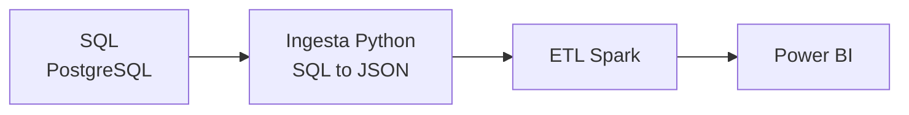

# Proyecto 02 · ITACA Relacional

## Descripción y objetivo

Mismo dashboard de análisis académico en Power BI que el Proyecto bigdata-p1-itaca, pero partiendo de una fuente de datos relacional en lugar de documental.

## Arquitectura



## Fuentes de datos

| Fuente | URL / origen | Formato | Frecuencia de actualización | Licencia | Última ingesta |
|---|---|---|---|---|---|
| ITACA (Conselleria de Educación) | Facilitada por el docente | SQL | Única | — | — |

## Estructura del repositorio

| Carpeta / fichero | Contenido |
|---|---|
| `ingesta/` | Scripts Python de lectura de PostgreSQL y conversión a JSON |
| `etl/` | Transformaciones con Spark |
| `dashboard/` | Informe de Power BI |
| `data/exported/` | Scripts SQL de ITACA |
| `data/raw/` | Datos en bruto: salida de la primera ingesta (BD convertida a JSON) |
| `data/staged/` | Datos intermedios |
| `data/curated/` | Datos finales para el dashboard |
| `docker-compose.yaml` | Servicios PostgreSQL y PGAdmin locales para desarrollo |
| `.env` | Variables de entorno. Hay que crearlo a partir de `.env.example` |
| `.env.example` | Plantilla de variables de entorno |

## Cómo desplegar el entorno

```bash
cp .env.example .env     # crea el fichero de variables de entorno (hay que rellenarlo)
docker compose up -d     # levanta los servicios en segundo plano
docker compose ps        # comprueba que los contenedores están en ejecución
```

PostgreSQL queda expuesto en `localhost:5432` y PGAdmin en `localhost:5050`.

## Bitácora de prácticas

### Bloque 0 · Entorno

**Objetivo:** crear el repositorio Git, la estructura de carpetas, el `.gitignore`, el entorno Docker y el README.

**Pasos realizados:**

- Creación de las ramas `main` y `develop` para separar el resultado final del desarrollo.
- Creación de la estructura de carpetas.
- Creación del `.gitignore`.
- Creación del entorno Docker.

**Problemas encontrados y solución:** —

**Resultado:** —

### Bloque 1 · Ingesta

**Objetivo:**

**Pasos realizados:**

**Problemas encontrados y solución:**

**Resultado:**

## Decisiones técnicas

| Decisión | Alternativa descartada | Motivo |
|---|---|---|
| PostgreSQL como almacenamiento | MongoDB | La fuente ya es relacional, así que se conserva el esquema SQL |
| Entorno con Docker Compose | Instalar PostgreSQL en local | Entorno reproducible: cualquiera lo levanta con un solo comando |
| Ramas `main` y `develop` | Trabajar solo en `main` | Separar el resultado final del desarrollo |

## Incidencias resueltas

| Problema | Causa | Solución |
|---|---|---|

## Resultado final
