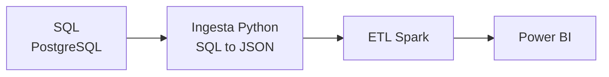

# Proyecto 02 · ITACA Relacional

## Descripción y objetivo

Mismo dashboard de análisis académico en Power BI que el Proyecto bigdata-p1-itaca, pero partiendo de una fuente de datos relacional en lugar de documental.

## Arquitectura



## Fuentes de datos

| Fuente | URL / origen | Formato | Frecuencia de actualización | Licencia | Última ingesta |
|---|---|---|---|---|---|
| ITACA (Conselleria de Educación) | Facilitada por el docente | SQL | Única | — | 2026-10-29 |

## Estructura del repositorio

| Carpeta / fichero | Contenido |
|---|---|
| `ingesta/` | Scripts Python de lectura de PostgreSQL y conversión a JSON |
| `ingesta/ingesta_itaca_bd.py` | Lee 4 tablas de ITACA, anonimiza el NIA y escribe los JSON |
| `etl/` | Transformaciones con Spark |
| `dashboard/` | Informe de Power BI |
| `data/exported/` | Scripts SQL de ITACA |
| `data/raw/` | Datos en bruto: salida de la primera ingesta (BD convertida a JSON) |
| `data/staged/` | Datos intermedios |
| `data/curated/` | Datos finales para el dashboard |
| `docker-compose.yaml` | Servicios PostgreSQL y PGAdmin locales para desarrollo |
| `.env` | Variables de entorno. Hay que crearlo a partir de `.env.example` |
| `.env.example` | Plantilla de variables de entorno |

## Cómo desplegar el entorno

```bash
cp .env.example .env     # crea el fichero de variables de entorno (hay que rellenarlo)
docker compose up -d     # levanta los servicios en segundo plano
docker compose ps        # comprueba que los contenedores están en ejecución
```

PostgreSQL queda expuesto en `localhost:5432` y PGAdmin en `localhost:5050`.

## Bitácora de prácticas

### Bloque 0 · Entorno

**Objetivo:** crear el repositorio Git, la estructura de carpetas, el `.gitignore`, el entorno Docker y el README.

**Pasos realizados:**

- Creación de las ramas `main` y `develop` para separar el resultado final del desarrollo.
- Creación de la estructura de carpetas.
- Creación del `.gitignore`.
- Creación del entorno Docker.

**Problemas encontrados y solución:** —

**Resultado:** —

### Bloque 1 · Ingesta

**Objetivo:** leer las tablas de ITACA desde PostgreSQL y dejar un JSON por tabla en `data/raw/`, con el NIA anonimizado.

**Pasos realizados:**

- Levantado el servicio PostgreSQL con `docker compose up -d` y cargar los datos.
- Instalar `psycopg2-binary` en el entorno virtual.
- Escribir `ingesta/ingesta_itaca_bd.py`: conexión con `POSTGRESQL`, leer la base de datos, hashear el NIA de la tabla alumnos y calificaciones y `logging` para capturar logs y errores del script.
- Ejecutar desde la raíz: `.venv/bin/python ingesta/ingesta_itaca_bd.py`.

**Problemas encontrados y solución:** --

**Resultado:** 

- 4 ficheros JSON en `data/raw/` con 7.193 alumnos, 106.814 calificaciones, 1.688 contenidos y 413 cursos; los recuentos coinciden con `count(*)`. 
- Ningún NIA original aparece en `alumnos` ni en `calificaciones`. 
- Con el contenedor parado el script termina con código 1.

## Decisiones técnicas

| Decisión | Alternativa descartada | Motivo |
|---|---|---|
| PostgreSQL como almacenamiento | MongoDB | La fuente ya es relacional, así que se conserva el esquema SQL |
| Entorno con Docker Compose | Instalar PostgreSQL en local | Entorno reproducible: cualquiera lo levanta con un solo comando |
| Ramas `main` y `develop` | Trabajar solo en `main` | Separar el resultado final del desarrollo |
| Anonimizar solo el NIA con `sha256(str(nia))[:10]` | No hashear nada | Proteger los datos personales de los Alumnos |
| `psycopg2` para leer de PostgreSQL | JDBC | Es Python nativo y no requiere drivers Java adicionales |

## Incidencias resueltas

| Problema | Causa | Solución |
|---|---|---|


## Resultado final
